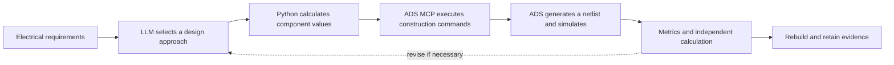

# Learning notes: designing the ideal LC low-pass filter with ADS MCP

These notes make the design decisions, calculations and verification observable.
Read each lesson as: **question -> prediction -> ADS action -> observation ->
conclusion**. Pause at the learning checkpoints and explain the result before
moving on.

This is a retrospective walkthrough of the completed baseline. The checkpoints
also define what to show during a future guided session.

The [task specification](../../tasks/inp-passive-lpf-65g-50ohm-80g-stop20/instruction.md)
owns the requirements. The [workspace README](README.md) owns the component table,
retained baseline and reproduction commands. These notes explain how to reach
and understand that baseline.

## 1. Understand who does each part



| Participant | Responsibility in a guided design session |
| --- | --- |
| LLM | Interpret the contract, choose a standard synthesis approach and margin, create scripts, explain decisions and inspect results |
| Synthesis code | Calculate normalized prototype values and scale them to the required impedance and frequency |
| ADS MCP | Discover the session and documentation, and execute Python inside the ADS process |
| ADS | Save native schematics, generate their netlist and numerically solve the circuit |
| Verification code | Measure real simulator data and compare it with an ABCD network calculation |
| Learner | Predict a result, inspect the current schematic and curves, and explain whether the evidence supports the decision |

The first synthesized electrical candidate passed. This baseline used a fixed
Chebyshev topology and analytic synthesis; no optimizer or topology search was
run. Subsequent corrections concerned execution, verification robustness and
presentation. The revision loop in the diagram describes how to proceed when a
future candidate fails.

## 2. Translate matching into a ripple budget

**Question.** How do the matching and insertion-loss requirements relate?

The relevant requirements are equal real 50 ohm references, a passband through
65 GHz, S11 and S22 strictly below -20 dB throughout that band, insertion loss
strictly below 1 dB, and S21 at exactly 80 GHz at most -20 dB. The current models
are ideal and lossless.

For power-normalized S parameters of this lossless network:

$$
|S_{11}|^2+|S_{21}|^2=1.
$$

Since 20*log10(|S11|) < -20 dB, |S11| < 0.1. Therefore:

$$
|S_{21}|^2>0.99,\qquad
IL=-10\log_{10}|S_{21}|^2
  <-10\log_{10}(0.99)
  =0.0436480540\ \mathrm{dB}.
$$

**Prediction.** Meeting the match requirement in the ideal lossless network
already imposes a much smaller insertion loss than 1 dB. Both metrics still
remain explicit acceptance checks.

For a 21 dB return-loss design target, define:

$$
\rho=10^{-21/20}=0.0891250938,\qquad
\epsilon=\frac{\rho}{\sqrt{1-\rho^2}}=0.0894811895.
$$

The corresponding passband insertion-loss ripple is:

$$
A_p=10\log_{10}(1+\epsilon^2)=0.0346349774555\ \mathrm{dB}.
$$

**ADS action and observation.** Use the passband sweep and exact extrema to
measure S11, S22 and insertion loss. The retained ADS baseline reaches -21 dB
matching and 0.0346349774555 dB maximum insertion loss.

**Conclusion.** The 21 dB target gives 1 dB of return-loss margin relative to the
strict 20 dB boundary. Positive insertion loss here includes power reflected
back to the source; an ideal reactive network can be lossless and still have
|S21| below one.

**Learning checkpoint:** explain why a 0.5 dB passband ripple would be
incompatible with this ideal network's matching requirement. The lossless
identity used above must be reconsidered when resistive loss is introduced.

## 3. Select the response and calculate the order

**Question.** How can the filter remain well matched through 65 GHz while
providing at least 20 dB attenuation at 80 GHz?

The chosen Chebyshev-I family has a known, bounded passband ripple:

$$
|S_{21}(f)|^2=\frac{1}{1+\epsilon^2T_n(f/f_p)^2},
\qquad f_p=65\ \mathrm{GHz}.
$$

For 0 <= f/fp <= 1, |Tn| <= 1. This gives the passband bound. Above the
passband, with x > 1:

$$
T_n(x)=\cosh\!\left(n\,\operatorname{acosh}(x)\right).
$$

To obtain attenuation As at fs = 80 GHz:

$$
n\ge
\frac{\operatorname{acosh}
\sqrt{(10^{A_s/10}-1)/\epsilon^2}}
{\operatorname{acosh}(f_s/f_p)}.
$$

**Prediction.** Substituting the 21 dB return-loss target gives:

| Stopband design target at 80 GHz | Order bound | Selected integer order |
| --- | ---: | ---: |
| 20 dB, the task requirement | 8.103339 | 9 |
| 23 dB, the internal margin target | 8.624994 | 9 |

Nine poles satisfy both estimates. The selected odd-order prototype also has
equal terminating coefficients g0 = g10 = 1. The complete nine-pole response
predicts S21(80 GHz) = -25.1637752971 dB.

**ADS action and observation.** Build the synthesized nine-pole ladder and
simulate an exact 80 GHz point. The measured result is
-25.1637752971 dB.

**Conclusion.** Nine is justified within this Chebyshev-I response family. This
calculation does not prove a minimum order across every allowed LC topology.
Other families were not simulated for comparison in the retained baseline.
The 23 dB target is design margin, not an additional acceptance requirement.

**Learning checkpoint:** explain why 65 GHz is the ripple boundary here rather
than a -3 dB cutoff.

## 4. Turn normalized coefficients into components

**Question.** Where do the values near 120 pH and 72 fF come from?

The normalized prototype uses:

$$
\gamma=\sinh\!\left(\frac{\operatorname{asinh}(1/\epsilon)}{n}\right),
\quad
a_k=\sin\frac{(2k-1)\pi}{2n},
\quad
b_k=\gamma^2+\sin^2\frac{k\pi}{n},
$$

$$
g_1=\frac{2a_1}{\gamma},\qquad
g_k=\frac{4a_{k-1}a_k}{b_{k-1}g_{k-1}},
\qquad k=2,\ldots,n.
$$

With R0 = 50 ohm and omega_p = 2*pi*65e9 = 4.08407044967e11 rad/s:

$$
L=\frac{R_0g_k}{\omega_p}
\quad\text{at series-L positions},\qquad
C=\frac{g_k}{R_0\omega_p}
\quad\text{at shunt-C positions}.
$$

For the first two ladder positions:

| Calculation | Result |
| --- | ---: |
| g1 | 0.985683519030 |
| L1 = 50*g1/omega_p | 120.674157213694 pH |
| g2 | 1.461256422959 |
| C1 = g2/(50*omega_p) | 71.5588254888531 fF |

The code names capacitors C1 through C4. Thus g2 becomes C1; the coefficient
index is the position in the alternating ladder, not the capacitor reference.
The [synthesis function](tools/analyze.py) calculates the complete table at full
floating-point precision.

```text
rfin -- L1 --+-- L2 --+-- L3 --+-- L4 --+-- L5 -- rfout
            C1       C2       C3       C4
            |        |        |        |
gnd --------+--------+--------+--------+
```

**ADS action.** Inspect the DUT schematic, its ordered rfin/rfout/gnd terminals,
and its generated netlist. The first two elements in the retained netlist are:

```text
L:L1  rfin n1 L=1.2067415721369464e-10 H R=0 Ohm Noise=no
C:C1  n1 gnd C=7.1558825488853105e-14 F
```

**Observation and conclusion.** L1 is series-connected and C1 shunts the next
node to the explicit ground terminal. Five series inductors and four shunt
capacitors implement the nine-pole ladder. At DC the inductors become shorts
and the capacitors open, giving a continuous signal path.

**Learning checkpoint:** check the unit conversion from H to pH and F to fF,
then identify the mirrored component pairs in the README table.

## 5. Watch the ADS construction and read the curves

**Question.** What should the learner inspect during the automated operations?

The [reconstruction script](tools/rebuild_ads.py) creates three native views:
the DUT schematic, its symbol and a separate SP testbench. It uses the ADS
Python design APIs. During the retained run, MCP invoked the script inside the
ADS process; the script can also run in a configured ADS Python environment.
The ADS simulator then solves the schematic-generated netlist.

| Visible checkpoint | Inspect before advancing |
| --- | --- |
| DUT constructed | Ordered terminals, alternating series/shunt connections, positive component values and explicit zero inductor resistance |
| Testbench connected | External 50 ohm Term1/Term2 at the DUT reference planes; gnd connected to ideal ground in the testbench |
| Netlist generated | Agreement with the schematic's node connections, values, units and permitted models |
| Sweep configured | Positive low-frequency samples, full passband, exact 65/80 GHz points and local refinement of every predicted maximum |
| Data returned | Raw ADS dataset, numerical metrics and plotted response, followed by an explanation of each result |

The positive-frequency reflection maxima satisfy:

$$
f_k=65\cos(k\pi/9)\ \mathrm{GHz},\qquad k=0,\ldots,4.
$$

They occur at approximately 11.2871, 32.5, 49.7929, 61.0800 and 65 GHz.
Predict five equal-height reflection peaks at -21 dB, with insertion-loss
maxima at the same frequencies. The S21 curve should then fall beyond the
passband and reach the predicted attenuation at 80 GHz.

Open the retained [passband plot](results/baseline-20261027/sparameters_passband.png)
and [broadband plot](results/baseline-20261027/sparameters_broadband.png).
The former exposes the ripple and its extrema; the latter shows the overall
low-pass response. Exact sweep settings and full-precision extrema remain in
the [baseline summary](results/baseline-20261027/summary.json).

**Observation.** ADS produced 3796 unique samples. All four acceptance checks
passed. Multiple theoretical peaks share the same worst value; tiny numerical
differences determine which frequency the maximum-search code reports.

**Conclusion.** Dense sampling, exact boundary points and analytic extrema
provide complementary evidence. The broad sweep through 120 GHz is diagnostic;
the specified stopband acceptance point is 80 GHz only.

**Learning checkpoint:** locate each peak, the 65 GHz edge and the exact
80 GHz sample. Explain the DC limit without claiming a zero-Hz SP simulation.

## 6. Check the solver result through another calculation

**Question.** How can we check that the simulated response matches the intended
network?

For each series inductor and shunt capacitor, form:

$$
M_L=\begin{bmatrix}1&j\omega L\\0&1\end{bmatrix},\qquad
M_C=\begin{bmatrix}1&0\\j\omega C&1\end{bmatrix}.
$$

Cascade them in circuit order. If the product is [[A,B],[C,D]], then:

$$
\Delta=A+B/R_0+CR_0+D,\qquad S_{21}=2/\Delta,
$$

$$
S_{11}=(A+B/R_0-CR_0-D)/\Delta.
$$

The analysis script computes the complete S matrix and compares complex
values at the actual ADS frequencies. It also checks reciprocity and
unitarity, and rejects missing, nonfinite or inadequately sampled evidence.

**Observation.** The retained maximum complex ADS/ABCD difference is
7.24e-13, below the 1e-6 target. The fresh-workspace rebuild reproduced the
same frequency array, complex results and netlist hash; seven verification
tests passed. See the [reproduction record](results/baseline-20261027/reproduction.json).

**Conclusion.** ADS and the matrix calculation agree on this ideal network.
They share the synthesized component parameters but use different solution
paths. This is engineering cross-checking, with physical InP implementation
and official benchmark validation remaining outside the current milestone.

The evidence links above point into ignored local results. When those files
are absent in a new checkout, use the README's reproduction instructions to
create a fresh run and open its generated figures and report.

## 7. Planned learning experiments

These experiments have **not been run in ADS**. The numeric predictions below
were calculated from the Chebyshev response formula; they are not additional
simulator measurements.

| Experiment | Hold fixed | Change | Analytic prediction or question |
| --- | --- | --- | --- |
| Order comparison | 21 dB return-loss target, 65 GHz edge, 50 ohm references | Resynthesize orders 5, 7 and 9 separately | S21 at 80 GHz: -4.11814, -13.75238 and -25.16378 dB respectively |
| Matching-margin comparison | Order 9, 65 GHz edge, 50 ohm references | Resynthesize for 25 dB return loss | Ripple falls to 0.01375536 dB, while S21 at 80 GHz becomes -21.16300 dB: the analytic response predicts all four task limits will pass, while the internal 23 dB attenuation target is missed |
| Component perturbation | Baseline testbench and all other elements | Increase only L3 by 5% in a copied candidate | Predict which parts of the response change, then measure the ripple, matching and 80 GHz transmission |

For the first two experiments, recompute all prototype coefficients and
component values. Removing elements from the nine-pole circuit or changing a
label does not implement a newly synthesized response. The existing scripts
are fixed to the baseline constants and require an explicit, reviewed
parameterization or separate candidate implementation for these experiments.

For every experiment:

1. Write a prediction before running ADS.
2. Save the candidate's parameter table and schematic.
3. Use a fresh output directory and the same acceptance measurements.
4. Overlay its curves with the baseline and compare numerical metrics.
5. Explain agreement or disagreement with the prediction and record the next
   design decision. Preserve the verified baseline.

## 8. Keep the teaching process observable

During future guided work, publish a checkpoint at each design decision:
state the question, show the formula and prediction, display the current
schematic or settings, run the required analysis, and explain the resulting
curve before advancing. Routine tool operations can proceed together.
The learner should be able to connect each design choice to its evidence.

Use this compact record in a learning session:

| Question | Choice or change | Prediction and reason | Evidence | Conclusion |
| --- | --- | --- | --- | --- |
| Which baseline meets the transition requirement? | Nine-pole Chebyshev-I, 21 dB return-loss target | Order bounds select 9; predicted 80 GHz S21 is -25.16378 dB | Baseline summary, netlist and independent calculation | Baseline passed and was reproduced |
| What happens at a lower order? | Planned order comparison | Formula predictions listed above | Awaiting separate ADS runs | Experiment pending |

Keep the [general ADS MCP workflow](../../docs/ads-mcp-workflow.md) for execution
and handoff mechanics. Use these notes to learn the electrical reasoning and
to record observable predictions, operations and outcomes.
